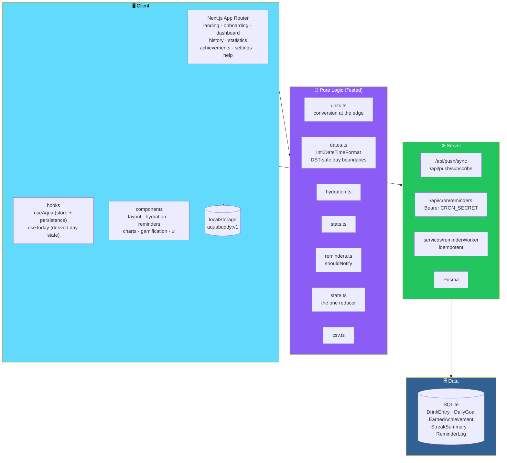

# 💧 AquaBuddy

<div align="center">


**A friendly hydration tracker.**

*Animated bottle & mascot · Playful reminders · Gentle gamification · History & statistics*

[🚀 Quick Start](#-quick-start) • [✨ Features](#-features) • [🏗️ Architecture](#-architecture) • [🔔 Reminders](#-reminders-and-web-push) • [🛡️ Safety](#-safety-notes)

</div>

---

## 📖 Overview

**AquaBuddy** is a **friendly hydration tracker**.

- 💧 **Animated bottle and mascot**
- 🔔 **Playful reminders**
- 🏆 **Gentle gamification**
- 📊 **History and statistics**
- 📱 **Installable as a PWA**
- 🌐 **Local-first** — no account needed

> ✅ **Includes the server pieces needed for reminders that arrive when the site is closed** — Web Push, VAPID, and an idempotent worker.

### ⚠️ Status — Please Read

> **The pure logic is covered by 31 unit and integration tests, which pass.**
>
> *(Units, time zones and DST, progress, streaks, XP, reminder scheduling, reducer, CSV.)*
>
> **The UI, API routes, and Prisma layer were written carefully but NOT YET RUN END TO END.**
>
> **This project was generated in an environment without network access** — so **`npm install`, `next build`, and a browser check are your first step**.
>
> **Expect to fix a small type or styling issue or two on first run, and please report anything you find.**

### Core Idea

> **Local-first, exact, and honest.**
>
> All state lives in one reducer persisted to `localStorage`. Drinks are integer millilitres. Days are derived from your time zone using the platform's tz database — **DST and midnight rollover are handled by the platform, not hand-rolled**.

---

## 🚀 Quick Start

```bash
npm install
cp .env.example .env        # Windows: copy .env.example .env
npm run setup               # prisma generate + migrate (creates the first migration) + seed
npm run dev                 # http://localhost:3000
npm test
```

> 📖 **See [`run.txt`](run.txt)** for the short version — **including Windows and Web Push steps**.

---

## ✨ Features

<div align="center">

| 🎬 Onboarding | 🫗 Dashboard |
|:---:|:---:|
| Animated mascot · target *(default 2,000 mL)* · wake/bed times · interval *(30/45/60/90/120)* · style *(Funny/Cute/Motivational/Minimal)* · units *(mL, L, US fl oz)* · **no account** | Animated glass bottle with **waves and bubbles** · exact mL · remaining and percent · **milestones at 25/50/75/100%** · mascot reactions · quick-add 100/150/250/500 mL · custom amounts · **undo, edit, and delete with restore** · timeline · mini-challenges · **confetti at 100%** · **going past 100% stays accurately tracked** |
| **🔔 Reminders** | **🏆 Gamification** |
| **100+ messages** with no-repeat rotation · active window *(quiet hours)* · snooze 10/15/30 · pause/resume · stop after goal and resume next day · in-app cards · browser notifications · **Web Push** | XP and levels · evolving mascot · streaks from your own targets · **10 badges** · daily challenges · optional sounds · **reduced motion** · **XP is capped so more logging or drinking earns nothing extra** |
| **📊 History and Stats** | **🎨 Design** |
| Day view · calendar · full timestamped list · **week/month/3-month bar charts with target line** · averages · totals · streaks · **CSV export** | Aqua/pastel **glass UI** · dark mode · mobile bottom nav + desktop sidebar · **skip link** · **keyboard focus** · **ARIA labels** · loading/empty/error states |
| **📱 PWA** | |
| Web manifest · icons · service worker *(offline fallback, push handling)* | |

</div>

### 🗺️ Pages

| Route | Purpose |
|-------|---------|
| **`/`** | Landing |
| **`/onboarding`** | Setup |
| **`/dashboard`** | Main hydration view |
| **`/history`** | Day-by-day log |
| **`/statistics`** | Charts and trends |
| **`/achievements`** | Badges |
| **`/settings`** | Reminder settings · profile · preferences |
| **`/help`** | Help and safety notes |

---

## 🏗️ Architecture

### System Overview



### 📂 Folder Layout

```
aquabuddy/
├── src/
│   ├── app/            Next.js App Router pages and API routes
│   ├── components/     layout · hydration · reminders
│   │                   charts · gamification · ui
│   ├── hooks/          useAqua (store + persistence)
│   │                   useToday (derived day state)
│   ├── lib/            pure, tested logic
│   │                   units · dates · hydration · stats
│   │                   reminders · state reducer · csv
│   ├── services/       reminderWorker (server)
│   └── data/           message pool (102 messages)
│                       achievement definitions
│
├── prisma/             schema.prisma · seed.ts
│                       (migrations are generated on first setup)
│
└── tests/              vitest unit + integration tests
```

### Design Principles

<div align="center">

| Principle | Implementation |
|-----------|---------------|
| **🏠 Local-first** | All state lives in **one reducer** (`lib/state.ts`) persisted to `localStorage` *(key `aquabuddy:v1`)* and synced across tabs |
| **🧪 Pure actions** | **Every mutation is a pure action** — the same reducer can later feed an account-sync layer |
| **💾 Schema mirror** | The Prisma models *(`DrinkEntry`, `DailyGoal`, `EarnedAchievement`, `StreakSummary`, …)* **already mirror the client data** |
| **🧮 Exact amounts** | **Drinks are integer millilitres.** Unit conversion happens **only at the input/display edge.** **Totals are integer sums** — percentages use **integer math** |
| **🌍 Time zones and DST** | Each drink stores an **absolute instant**. The "day" is derived with **`Intl.DateTimeFormat`** in the user's time zone — **DST and midnight rollover handled by the platform's tz database** |
| **📸 Goal snapshots** | Each local day keeps a snapshot of the goal in effect — **changing your target never rewrites history** |
| **🔒 No accounts, no leakage** | A browser-generated 48-hex **`deviceId`** acts as a bearer capability for **its own data** — unsubscribe is scoped to the owning device |
| **🛡️ Defense in depth** | Zod validation on every API body · https required · constant-time cron secret comparison · in-memory rate limiting |

</div>

### ⚠️ A Known Limitation — Schedule Shape

> **Bedtime must be later than wake-up on the same calendar day** *(at least 4 hours)*.
>
> **Overnight schedules** *(for example wake 15:00, bed 02:00)* **are not supported yet**.

---

## 🔔 Reminders and Web Push

> **A browser-only timer cannot run when the page is closed.**
>
> **AquaBuddy therefore has two layers.**

### 1️⃣ In-App Engine

**`ReminderEngine`:**

- Checks **every 15 seconds** while the app is open
- Shows a **card** with Log / Snooze actions
- Shows a **browser notification** if you granted permission — **requested only after you click a button**

### 2️⃣ Server Web Push *(Opt-In)*

**Flow:**

1. The client syncs preferences and today's total to **`/api/push/sync`**
2. Registers a push subscription at **`/api/push/subscribe`**
3. A worker sends notifications

### 🛠️ Setup

```bash
npm run vapid          # prints NEXT_PUBLIC_VAPID_PUBLIC_KEY / VAPID_PRIVATE_KEY
# put them in .env, plus VAPID_SUBJECT and CRON_SECRET

npm run worker         # self-hosted loop, every 60 s
# or call GET/POST /api/cron/reminders every minute with  Authorization: Bearer $CRON_SECRET
```

### 🔒 How the Worker Stays Correct

**`src/services/reminderWorker.ts`:**

<div align="center">

| Guarantee | Implementation |
|-----------|---------------|
| **Same decision function as the client** | **`shouldNotify`** — respects active hours *(quiet hours)*, pause, snooze, and the goal. **Goal progress is compared against *today's* local date**, so reminders **resume automatically on the next day** |
| **Idempotent** | Before each send it **inserts a `ReminderLog` row with a unique `(subscriptionId, slotKey)`**. **Overlapping workers or retries cannot deliver the same slot twice.** Transient failures **release the slot** so the next run can retry inside a **15-minute grace window** |
| **Cleanup** | **Expired subscriptions** *(HTTP 404/410)* **are deleted** |
| **No double notification** | If the app is open and focused, **the service worker skips the system notification** — the in-app card covers it |

</div>

### 🔐 Security Model

> **There are no accounts.**

<div align="center">

| Protection | Implementation |
|-----------|---------------|
| **Capability tokens** | A browser-generated **48-hex `deviceId`** acts as a **bearer capability for its own data** |
| **Input validation** | **All API bodies are validated with zod** |
| **Transport** | Endpoints **must be `https`** |
| **Scoped unsubscribe** | **Scoped to the owning device** |
| **Cron security** | **Bearer secret, compared in constant time** |
| **Rate limiting** | Small **in-memory** limiter — **swap for Redis if you run several instances** |

</div>

> ⚠️ **Add real authentication when you add accounts.**

---

## 🚢 Deployment

### 🔒 HTTPS Required

**Service workers and push require HTTPS** *(localhost is exempt)*.

### 🗄️ Database

<div align="center">

| Host | Approach |
|------|----------|
| **Local development** | SQLite |
| **Single-node with persistent disk** — VPS, Fly.io volume, Railway volume, Docker volume | SQLite works |
| **Serverless hosts (Vercel)** | **Switch the datasource in `schema.prisma` to PostgreSQL**, set `DATABASE_URL`, regenerate migrations, and run `npx prisma migrate deploy` |

</div>

### ⏰ Scheduler

**Reliable background reminders need something that runs the worker every minute:**

- **`npm run worker`** as a long-running process — systemd, PM2, Docker
- **A platform cron hitting `/api/cron/reminders`** — `vercel.json` includes an every-minute cron, which requires a plan that allows it
- **Any external scheduler**

### 🔑 Environment Variables

Set in the host's environment:

- `NEXT_PUBLIC_VAPID_PUBLIC_KEY`
- `VAPID_PRIVATE_KEY`
- `VAPID_SUBJECT`
- `CRON_SECRET`
- `DATABASE_URL`

> ⚠️ **The public key is baked in at build time.**

### 📱 iOS

> **iOS only supports Web Push for apps added to the Home Screen.**

---

## 🧪 Testing

```bash
npm test
```

### 📋 Unit Tests — `tests/hydration.test.ts`

<div align="center">

| Area | Coverage |
|------|:--------:|
| **Unit conversion** | ✅ |
| **Validation** | ✅ |
| **Progress and over-100%** | ✅ |
| **No-drift sums** | ✅ |
| **Local-midnight and DST day boundaries** | ✅ |
| **Time-zone conversion** | ✅ |
| **Streaks and XP caps** | ✅ |
| **Message pool size and no-repeat** | ✅ |
| **Reminder scheduling** — quiet hours, snooze, pause, goal, next-day resume | ✅ |
| **CSV safety** | ✅ |

</div>

### 🔗 Integration Tests — `tests/integration.test.ts`

<div align="center">

| Area | Coverage |
|------|:--------:|
| **Logging, editing, deleting, restoring, and undoing drinks** through the **real reducer** | ✅ |
| **Per-day goal snapshots** | ✅ |
| **Badge earning** | ✅ |
| **Persistence round-trip and corrupt-data handling** | ✅ |

</div>

---

## 🛡️ Safety Notes

> **This is what AquaBuddy promises about its framing.**

<div align="center">

| Guarantee | Implementation |
|-----------|---------------|
| **Targets are user-set** | **The app says so on onboarding, Help, and the landing page** |
| **Never a medical recommendation** | **It never frames a target as medical advice** |
| **Large-entry warning** | **Warns on entries of 1,000 mL or more** |
| **Hard limit** | **Rejects entries above 5,000 mL** |
| **No reward for overdrinking** | **Gives no reward for exceeding the target** |
| **Supportive copy** | **Keeps reminder copy supportive rather than guilt-inducing** |

</div>

---

## 🗄️ Database Migrations and Seed

**`npm run setup` runs:**

```bash
prisma migrate dev --name init
```

**This:**

1. **Generates `prisma/migrations/*`** from `schema.prisma`
2. **Applies it**
3. **Seeds the achievement definitions** with `prisma/seed.ts`

> ✅ **Commit the generated `prisma/migrations` folder.**
>
> **In production use `npm run db:deploy`.**

---

## ⚠️ Known Gaps / Next Steps

<div align="center">

| Gap | Details |
|-----|---------|
| **No account sync yet** | **Schema is ready** — server-side data is **only what push needs** |
| **Overnight active windows** | **Cross-midnight schedules are not supported yet** |
| **Empty sound files folder** | `public/sounds` is empty because **sounds are synthesized with the Web Audio API** |
| **No Playwright e2e tests** | Not included |

</div>

---

## 🗺️ Roadmap

### ✅ Current

- [x] Animated mascot and glass bottle with waves and bubbles
- [x] Onboarding with target, wake/bed times, interval, style, and units
- [x] No-account setup — local-first
- [x] Exact integer-millilitre tracking
- [x] Unit conversion only at input and display
- [x] Milestones at 25 / 50 / 75 / 100%
- [x] Quick-add amounts and custom amounts
- [x] Undo, edit, and delete with restore
- [x] Timeline and mini-challenges
- [x] Confetti at 100% — and accurate tracking past 100%
- [x] 100+ reminder messages with no-repeat rotation
- [x] Active window, snooze, pause, goal-stop, and next-day resume
- [x] In-app reminder cards and browser notifications
- [x] XP, levels, evolving mascot, streaks, 10 badges, daily challenges
- [x] XP caps — no reward for extra logging or overdrinking
- [x] Optional sounds and reduced motion
- [x] Day view, calendar, full timestamped list
- [x] Week / month / 3-month bar charts with target line
- [x] Averages, totals, streaks, CSV export
- [x] Aqua/pastel glass UI and dark mode
- [x] Mobile bottom nav and desktop sidebar
- [x] Skip link, keyboard focus, ARIA labels, loading/empty/error states
- [x] PWA manifest, icons, service worker
- [x] Web Push with VAPID configuration
- [x] Idempotent reminder worker with slot-based deduplication
- [x] Expired subscription cleanup
- [x] Same decision function on client and server
- [x] Time zones and DST handled by `Intl.DateTimeFormat`
- [x] Per-day goal snapshots
- [x] One reducer persisted to `localStorage` and synced across tabs
- [x] Zod validation on all API bodies
- [x] Constant-time cron secret comparison
- [x] Safety framing on onboarding, Help, and landing
- [x] 31 passing unit and integration tests

### 🔜 Future Ideas

- [ ] **Run the UI end to end** — `npm install`, `next build`, browser check
- [ ] **Account sync** — schema is already modeled
- [ ] **Overnight active windows** — cross-midnight schedules
- [ ] **Playwright end-to-end tests**
- [ ] **Shared rate limiter** — Redis-backed for multi-instance
- [ ] **Native mobile apps** — for more reliable background reminders
- [ ] **Widgets** — home-screen hydration glance
- [ ] **Localization** — bilingual UI
- [ ] **Data export** — JSON alongside CSV
- [ ] **Wearable integration** — Apple Watch, Wear OS

---

## 🤝 Contributing

Contributions are welcome. Please:

1. Fork the repository
2. **Keep the reducer pure** — every mutation is an action; the client and server share the same logic
3. **Keep amounts as integers** — conversion only at input and display
4. **Use `Intl.DateTimeFormat` for day boundaries** — never hand-roll DST
5. **Keep reminder decisions in `shouldNotify`** — one function for client and server
6. **Preserve idempotency** — every send must insert a unique `(subscriptionId, slotKey)` first
7. **Keep the safety framing** — no medical claims, no overdrinking rewards, supportive copy only
8. **Never add a reward for exceeding the target**
9. **Update tests** when changing logic
10. Submit a Pull Request

### Guidelines

- **Never frame a target as medical advice**
- **Never reward overdrinking**
- **Never log drinks above 5,000 mL**
- **Never skip the schema mirror** when adding new state
- **Never bypass `deviceId` scoping** in unsubscribe
- **Never commit a real `.env`** — use `.env.example` as the template

---

## 📜 License

MIT — see [LICENSE](LICENSE) for details.

---

## 🙏 Acknowledgments

- **Next.js and React** — for a client that stays fast under animated UI
- **Prisma** — for a schema that mirrors the client reducer
- **The Web Push and VAPID specs** — for making notifications possible when the site is closed
- **Every water bottle that ever sat next to a keyboard, forgotten** — this one's for you

---

<div align="center">

### 💧 DRINK. LOG. REMEMBER. TRACK.

**A friendly hydration tracker.**

**Local-first. Exact amounts. No medical claims.**

<br>

> ⚠️ **Pure logic tested and passing (31/31). UI and API still need a real end-to-end run.**

<br>

⭐ If AquaBuddy helped you remember, consider giving it a star.

<br>

[⬆ Back to Top](#-aquabuddy-)

</div>
